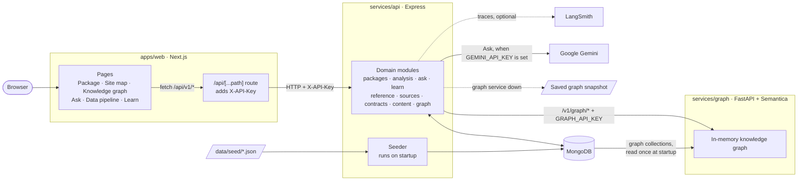
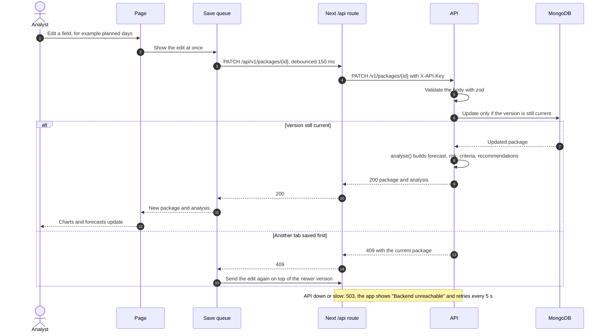
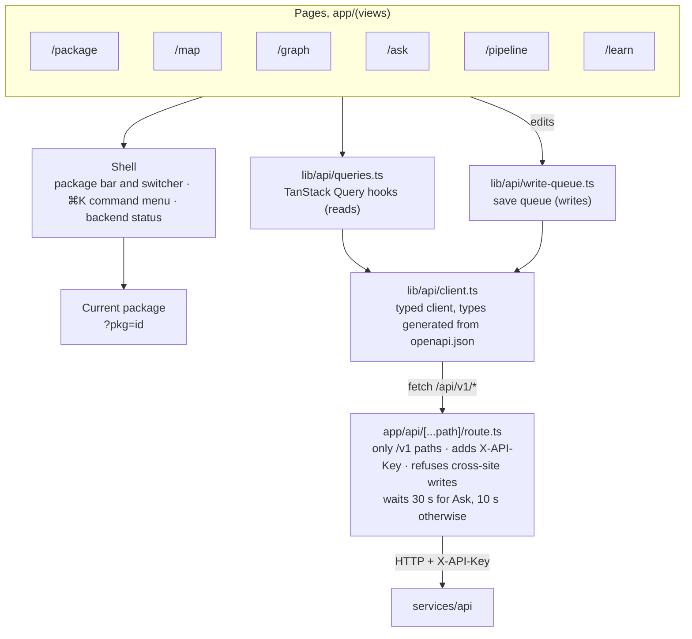
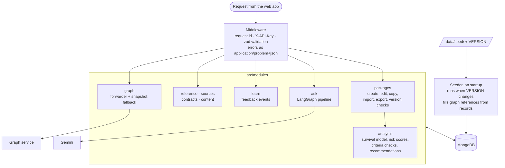
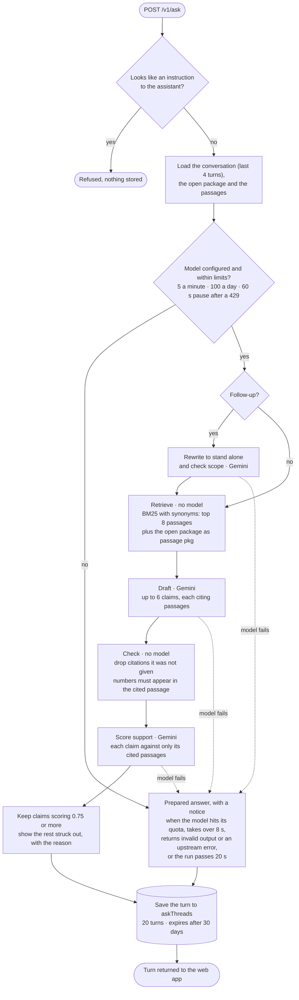
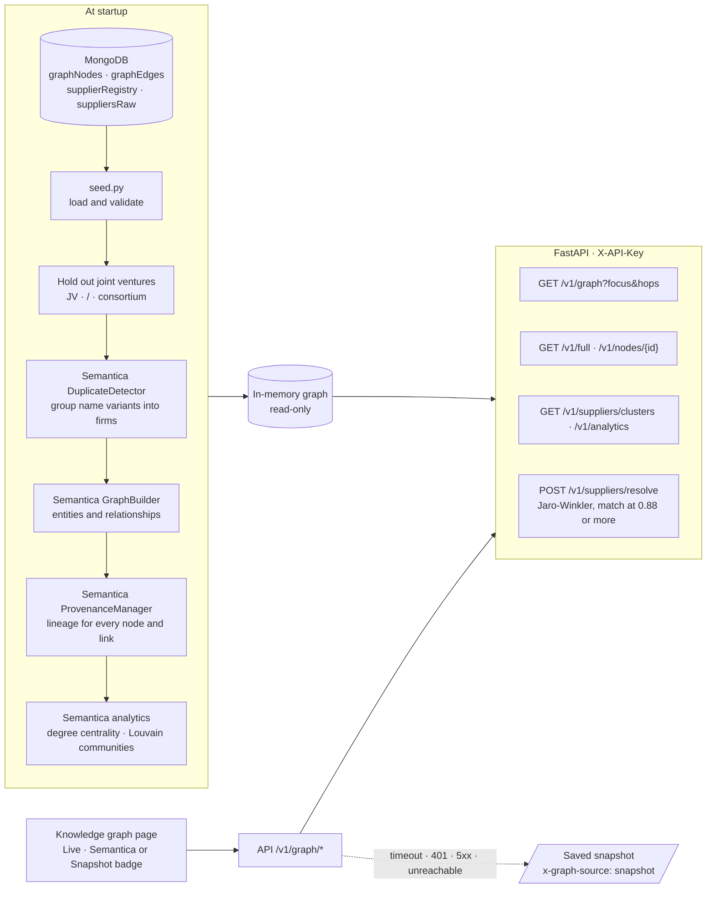

# Procurement Intelligence

A procurement intelligence platform on World Bank open-data sources. One working package moves through the procurement lifecycle, and every recommendation links to the record or document passage that supports it.

Three services, one repository:

- **`apps/web`**: Next.js 16 (App Router, TypeScript), Tailwind CSS v4, shadcn/ui, Recharts, React Flow for the knowledge graph, MapLibre. A pure client of the API: it holds no domain data and computes no forecasts.
- **`services/api`**: Node.js, Express 5, MongoDB (Mongoose). The system of record and the business logic: reference data, evidence, saved packages, the forecasting and risk model, tender criteria checks, recommendations, Ask and Learn. It also fronts the graph service.
- **`services/graph`**: FastAPI and [Semantica](https://github.com/semantica-agi/semantica). Builds the knowledge graph from the graph collections the API seeds into MongoDB, resolves supplier names, records provenance, computes graph analytics.

Docs: [architecture](docs/architecture.md), [design system](docs/design-system.md), [backend design](docs/superpowers/specs/2026-11-18-express-mongodb-backend-design.md).

## How it works

The diagrams below render on GitHub. Each one zooms in on one part. The details behind them are in [architecture](docs/architecture.md).

### The whole system

The browser talks only to the web app. The web app's `/api` route forwards to the API and adds the secret key. The API owns the data and the logic. It calls the graph service, Gemini and LangSmith; the browser never reaches them directly.



### Editing a package, end to end

Every change to a package follows this path. The analysis (forecast, risk, criteria checks, recommendations) is recomputed by the API on each save and returned with the package.



### Web app (`apps/web`)

The web app holds no domain data and computes nothing. Pages read through TanStack Query hooks and write through the save queue. Both go through one typed client to the `/api` route.



### API (`services/api`)

The API is the system of record. Each domain is one folder with its model, schemas, service and routes. On startup the seeder loads `data/seed/` into MongoDB when its version changes. It never touches saved packages.



### Ask the evidence

A LangGraph state graph runs once per question. The model is called at most three times: to rewrite a follow-up, to draft, and to score support. Every other step is plain code. If any model step fails or the run passes 20 s, the answer comes from prepared answers instead, with a notice.



When `LANGSMITH_TRACING` and `LANGSMITH_API_KEY` are set, each run is traced in LangSmith with its thread, package and request id.

### Knowledge graph (`services/graph`)

The graph service builds its graph once, at startup, from the collections the API seeded. After that it only answers reads, plus name matching. Semantica does the building, deduplication, provenance and analytics; the service's own code holds joint ventures out of deduplication and finds neighbourhoods.



## Quick start

```bash
docker compose up --build        # web on http://localhost:3000; API :4000, graph :8000, MongoDB :27017 (localhost only)
```

On first start the API loads `data/seed/` into MongoDB, including the read-only **example package**.

### Without Docker

Prerequisites: Node 24+, [uv](https://docs.astral.sh/uv/) (it installs Python 3.12 for the graph service), and a MongoDB 8 (`docker compose up -d mongo` is the quickest).

```bash
docker compose up -d mongo                                                     # MongoDB on localhost:27017
cd services/api && npm install && npm run dev                                  # API on :4000, seeds on start
cd services/graph && uv sync && MONGO_URL=mongodb://localhost:27017 uv run uvicorn app.main:app --reload --port 8000
cd apps/web && npm install && npm run dev                                      # http://localhost:3000
```

Start the API before the graph service: the graph service reads the collections the API seeds. If the graph service is down, the API answers graph requests from a saved snapshot and the app shows a **Snapshot** badge instead of **Live · Semantica**. If the API is down, the app shows **Backend unreachable** and reconnects on its own.

### Environment

| Variable | Where | Default | Purpose |
|---|---|---|---|
| `MONGO_URL` | API, graph | `mongodb://localhost:27017/procurement` (API) | MongoDB. The graph service also takes `MONGO_DB` (default `procurement`) |
| `API_KEY` | web, API | `dev-key` | Shared secret the web server sends to the API as `X-API-Key` |
| `API_URL` | web (server only) | `http://localhost:4000` | Where the web app's `/api/*` route reaches the API |
| `GRAPH_API_KEY` | API, graph | `dev-key` | Shared secret the API sends to the graph service |
| `GRAPH_SERVICE_URL` | API | `http://localhost:8000` | Where the API reaches the graph service |
| `EXPOSE_DOCS` | API, graph | `false` | Serve interactive API docs at `/docs`. Keep it off on public deployments |
| `SEED_DIR` | API, graph | `data/seed` (API) | Seed files. The graph service uses it only without `MONGO_URL` (tests use `tests/fixtures/seed`) |
| `GEMINI_API_KEY` | API | unset | Turns on the live model for **Ask the evidence**. Without it, Ask answers from prepared answers and says so. Free key: [Google AI Studio](https://aistudio.google.com/apikey) |
| `GEMINI_MODEL` | API | `gemini-3.5-flash-lite` | Gemini model id |
| `ASK_RPM`, `ASK_DAILY_LIMIT` | API | `5`, `100` | Questions per minute and per UTC day sent to the model, across all users. Over either, Ask uses prepared answers |
| `LANGSMITH_TRACING`, `LANGSMITH_API_KEY` | API | off | Trace every Ask run in LangSmith when both are set. `LANGSMITH_ENDPOINT` for a non-US workspace region. Runs go to the agent named by `LANGSMITH_AGENT_ID` + `LANGSMITH_AGENT_ENVIRONMENT` (`local`, `development`, `staging` or `production`), or else to `LANGSMITH_PROJECT` (default `procurement-ask`) |

`npm run dev` in `services/api` and `docker compose` both read `services/api/.env` (see `.env.example`); put `GEMINI_API_KEY` there. After changing it, restart the API (`docker compose up -d api`). Use long random keys outside local development. The keys only default to `dev-key` in development: in production (`NODE_ENV=production`) the API refuses to start without `API_KEY` and `GRAPH_API_KEY`, and the web app's `/api` route refuses to forward without `API_KEY`. The route also refuses writes sent by other sites (`Sec-Fetch-Site: cross-site` or a foreign `Origin`).

## Tests

```bash
cd services/api && npm test            # Vitest + supertest on an in-memory MongoDB: model, packages, seeding, graph derivation, proxy, Ask pipeline, contract
cd services/api && npm run eval:ask    # manual: the five suggested questions against the live model (needs GEMINI_API_KEY; spends quota)
cd services/graph && uv run pytest     # graph build, supplier merges, provenance, API contract, Mongo seed loader
cd apps/web && npm test                # Vitest: API proxy, save queue, legacy import, layout, geometry
cd apps/web && npm run test:e2e        # Playwright, desktop + 390 px phone, against MongoDB, the API and the graph service
cd apps/web && npm run test:e2e:dev    # hydration check against `next dev`
```

Playwright starts MongoDB (Docker Compose), the API, the graph service and the web app, reusing any that are already running. Tests never call a real model: Ask runs on prepared answers, or on a deterministic stand-in model that the API accepts only in E2E mode (`x-ask-model: fake`). Map tiles, terrain and elevation are served from local stubs. Every page is also checked for accessibility (axe, in both themes), console errors and horizontal overflow. CI runs all suites on every push and pull request.

Contracts are generated, never hand-edited:

- `npm run contracts` (repo root) rewrites `services/api/openapi.json`, the graph service's test fixture (`services/graph/tests/fixtures/seed`) and the web app's API types. CI fails if either generated file is out of date.
- After changing the graph service's response models, run `npm run snapshot` with the graph service running. It regenerates the API's offline graph snapshot and the graph API types.

## Getting around quickly

- **Packages** are saved on the server. Switch, create, duplicate or delete them from the menu next to the package name; `?pkg=<id>` links to one. The **example** is read-only: your first edit saves a copy and switches to it.
- **Package** puts plan, tender design and execution on one page: a summary strip, three stage columns, and tabbed details. The details cover market approach, signature curve, risk drivers, progress, milestones, disbursement vs peers, who wins, evidence conflict and precedents.
- **⌘K / Ctrl+K** (or `/`) opens the command menu: jump to a view, a package section or a contract, run an action, or ask a question.
- **1–6** switch views when you aren't typing in a field.
- Package fields in the top bar can be edited in place from any view, and results update live. Drag the plan line on the comparables strip to change the planned duration.
- **Sign off** a brief by name; any later change marks it as changed since sign-off.
- **Knowledge graph**:
  - Explore the live graph (pan, zoom, drag nodes) and centre it on any node.
  - See each node's provenance and the most connected entities.
  - Group nodes by community.
  - Resolve your own supplier names against known firms.
- **Theme:** dark by default; switch to light from the rail.

## Bringing your own data

Everything you change is saved to your current package on the server, not to the browser.

- **Countries:** choose *Add a country…* in the Country menu, or edit any country's CPIA, WGI regulatory quality and fragility under **More**. They belong to this package, and the forecasts use them immediately.
- **Sectors:** type any sector under **More**.
- **Contracts:** *Add your own contract* in the Execution column. The API computes the warning score and signals from progress and payment days and tags them as your data.
- **Supplier names:** paste award-row names under Knowledge graph → Supplier name resolution.
- **Scenarios:** **Export** downloads the package as JSON; **Import** creates a new package from a file; **Reset** restores a package to the example. Files exported by earlier versions still load, and a scenario saved in this browser by an earlier version is imported once as a new package.

## Where each module from the brief lives

| Brief | In the app |
| --- | --- |
| Module 1: ingestion, knowledge graph, chunking | **Data pipeline**: live graph service health, feeds with their World Bank API endpoints, processing stages, structure-aware ICR chunking, missing-data handling. **Knowledge graph**: built by Semantica, with exact vs scored links, provenance per node, supplier deduplication with joint ventures kept separate |
| Module 2: predictive and prescriptive engines | **Plan**: survival-model time to signature (P50/P80, chance of meeting the plan), re-tender / amendment / slippage risk with drivers, method counterfactuals, recommended actions, agent retrieval trace. **Tender design**: criteria and specification checks that feed back into re-tender risk |
| Module 3: guardrails and attribution | Citation chips coloured by evidence layer, which open the exact source passage. **Ask the evidence**: claim-level grounding check that removes unsupported sentences, plus a guard against instructions to the assistant. **Execution**: weighting of conflicting ISR vs ICR evidence |
| Module 4: continuous learning and rollout | **Learn**: feedback events and what each one updated, model/index health with retrain triggers, phased pilot, KPIs |
| Geospatial monitoring | **Site map**: road contracts on Sentinel-2 imagery, chainage segments and km posts, reported vs satellite-observed progress, 2019 vs 2024 swipe comparison, 3D terrain, high-resolution close view of any kilometre, a drive along the alignment, and a real elevation profile with grades |

## Site map data

| Layer | Source | Notes |
| --- | --- | --- |
| Satellite imagery | [Sentinel-2 cloudless](https://s2maps.eu) annual mosaics by EOX IT Services GmbH (2018–2024 available) | 10 m resolution. The 2018+ mosaics are licensed CC BY-NC-SA 4.0: fine for a demo, but commercial use needs an EOX licence or self-processed Copernicus data |
| High-resolution basemap | Esri World Imagery | Subject to Esri's terms of use |
| Terrain (3D) and elevation profile | AWS Terrain Tiles (Terrarium encoding) | No key needed. The profile samples real elevation every 250 m along the alignment |
| Road alignments | OpenStreetMap, routed via OSRM (`data/seed/roads.json`, served by the API) | ODbL. Status per chainage segment and change values are illustrative |

A production version would compute change per segment from individual Sentinel-2 L2A scenes (for example through Microsoft Planetary Computer or Copernicus Data Space STAC), rather than relying on annual mosaics.

## Notes

- **What's real:** the imagery, road geometry, elevation and Semantica's graph processing.
- **What's illustrative:** all other data. Records follow the shapes of World Bank Contract Awards, Projects, Finances, Documents & Reports, CPIA and WGI data, but the project IDs, firms, passages and figures are synthetic. All of it lives in `data/seed/` and is loaded into MongoDB by the API.
- **The models** in `services/api/src/modules/analysis/` are linearised stand-ins (a Weibull time-to-award model and logistic risk scores). They respond to every input, but they were not fitted to real data.
- **Ask the evidence** calls a real model (Gemini, through LangChain and LangGraph) when `GEMINI_API_KEY` is set; see [Ask the evidence](docs/architecture.md#ask-the-evidence). Without a key, or when the model is over quota, slow or returns something unusable, it falls back to prepared answers and says so. Gemini's free tier may use prompts to improve Google's products; that is acceptable here only because all the data is synthetic.
- **No accounts:** everyone who can reach the app sees and edits the same saved packages. Two people editing the same package at once is handled by version checks: the later save is re-applied on top, and the app says so.
